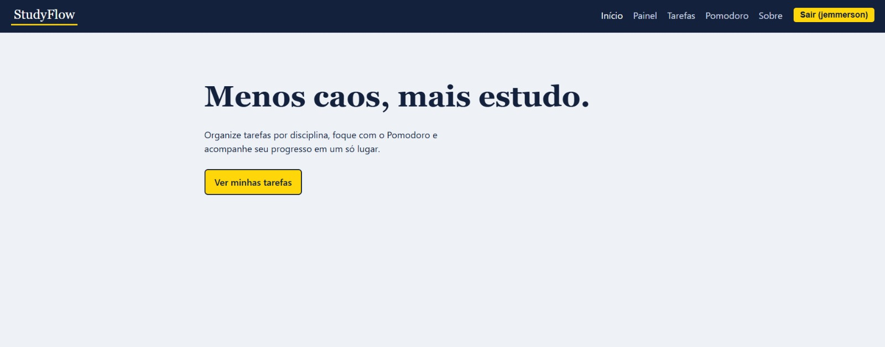
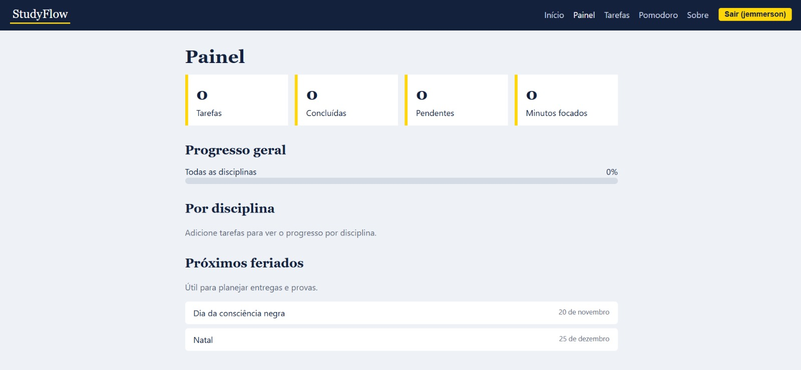
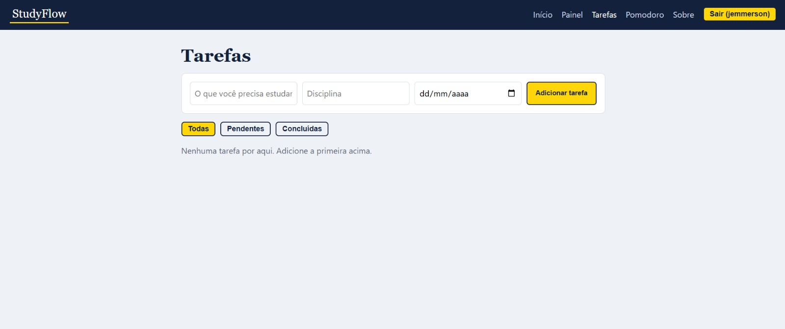
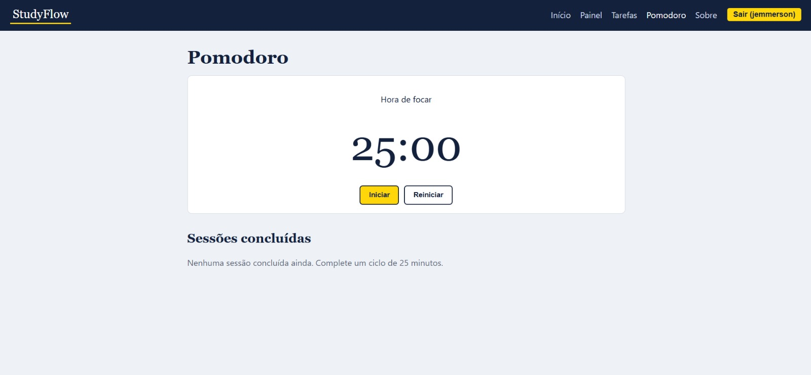
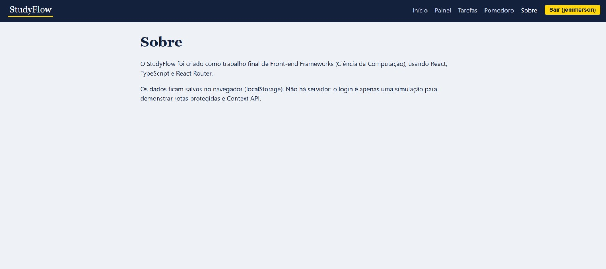

# StudyFlow

Organizador de estudos para universitários: tarefas por disciplina, timer Pomodoro e painel de progresso.
Trabalho final de Front-end Frameworks (Ciência da Computação) — React + TypeScript.

## Como rodar
```bash
npm install
npm run dev      # abre em http://localhost:5173
npm run build    # gera a versão de produção
```

## Páginas (6)
Início `/`, Entrar `/login`, Painel `/dashboard`, Tarefas `/tarefas`, Pomodoro `/pomodoro`, Sobre `/sobre`.
Painel, Tarefas e Pomodoro exigem login (login simulado: qualquer nome + senha com 4+ caracteres).

## Componentes (11)
| Componente | Responsável |
|---|---|
| Header | (jemmerson) |
| StatCard | (joao vitor) |
| ProgressBar | (joao vitor) |
| TaskForm | (Fabricio) |
| TaskItem | (Fabricio) |
| TaskList | (Fabricio) |
| LoginForm | (jemmerson) |
| PomodoroTimer | (joao vitor) |
| SessionHistory | (joao vitor) |
| ProtectedRoute | (jemmerson) |
| HolidayList | (nome do aluno) |

## Hooks (9)
`useState`, `useEffect`, `useContext` (AuthContext e TasksContext), `useRef` (TaskForm e PomodoroTimer), `useMemo` (Painel e Tarefas), `useReducer` (TasksContext), `useCallback` (Pomodoro) e os custom hooks `useLocalStorage` e `useFetch`.

## API (ponto extra)
O Painel consome a **BrasilAPI** (`https://brasilapi.com.br/api/feriados/v1/{ano}`) para listar os próximos feriados nacionais, usando o custom hook `useFetch` com estados de carregando e erro.

## Membros do grupo
- (Fabricio de souza carvalho-01790981)
- (João Vitor Viana de Azevedo-01784017)
- (Jemmerson da silva rocha-01796930)

## Telas










